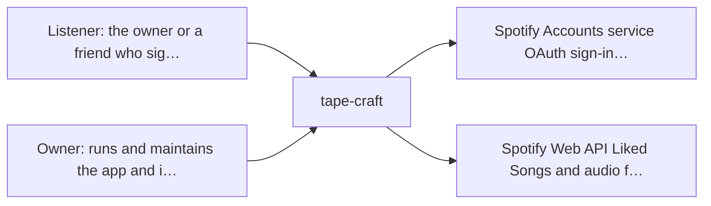
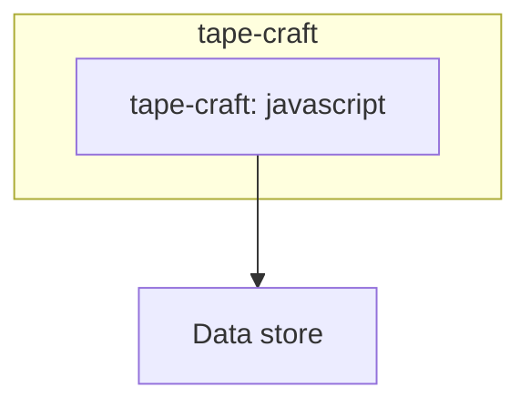

# tape-craft

Tool using Spotify API that makes sense of your Liked Songs and crafts playlists based on your needs.

## Problem

A Spotify user's Liked Songs grows into one huge unsorted list. Sorting it into mood, genre or activity playlists by hand is tedious, and Spotify offers no tool for it. tape-craft analyses the Liked Songs library and crafts playlists based on what the user needs.

## Users

- Listener: the owner or a friend who signs in with their own Spotify account to organise their own Liked Songs into playlists
- Owner: runs and maintains the app and its Spotify developer app registration (through server access)

## Core user journeys

- Sign in with Spotify.
- Sync and analyse Liked Songs.
- Describe a need (mood, genre or activity) and preview a generated playlist.
- Save the playlist to the user's Spotify account.
- Revisit and regenerate saved playlists.

## Data

Spotify OAuth access and refresh tokens per user; Liked Songs metadata (track, album and artist IDs and names, genres, audio features); playlists the app creates in the user's Spotify account.

## Scale and service levels

Up to 50 users, each with up to 10,000 Liked Songs; low traffic, well under 1 request per second; Spotify Web API rate limits are the main constraint.

99% monthly uptime; web UI pages p95 under 500 ms; generating a playlist from a 10,000-song library under 30 s.

RPO 24 hours (daily database backups); RTO 4 hours. Liked Songs data can also be re-fetched from Spotify.

## Security

**Authentication.** Users sign in with Spotify OAuth 2.0 authorization code flow with PKCE; the app authenticates to Spotify with its client ID and secret; the app session is kept in a secure cookie.

**Authorisation.** One role, Listener: each user may read only their own Liked Songs and analysis and create, view or manage only playlists in their own Spotify account. The owner administers the app through server access; there is no admin role or UI.

**Boundaries.** Public: landing page and Spotify sign-in. Signed-in only: web UI and API. No admin-only area. Untrusted input enters through user form and API input (playlist criteria, playlist names), OAuth callback parameters, and Spotify API responses.

## Integrations

- Spotify Accounts service (OAuth sign-in and token refresh)
- Spotify Web API (Liked Songs and audio features and playlists)

## Compliance

GDPR (personal data of EU users) and the Spotify Developer Terms and Developer Policy.

Personal data (Spotify user ID, profile, OAuth tokens, cached library) is kept in the app database while the user is active. 'Delete my data' removes tokens and cached library immediately. Accounts inactive for 12 months are purged. Backups expire within 30 days.

## Architecture

### System context

### Containers

---

_Generated by `sentinel setup` from `.sentinel/domain.json`._
